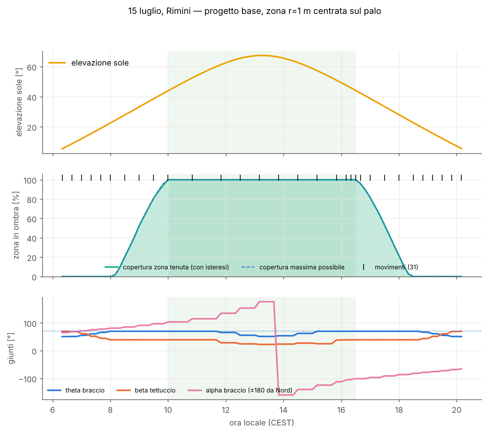
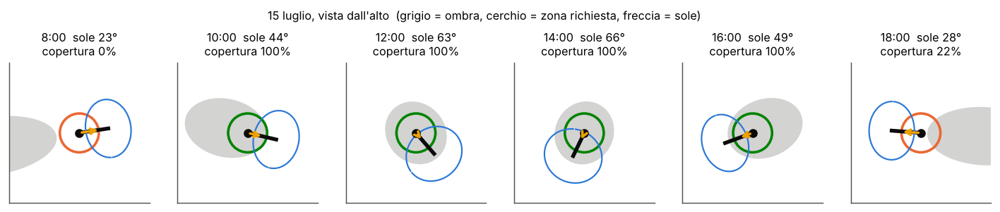
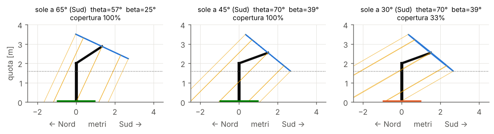
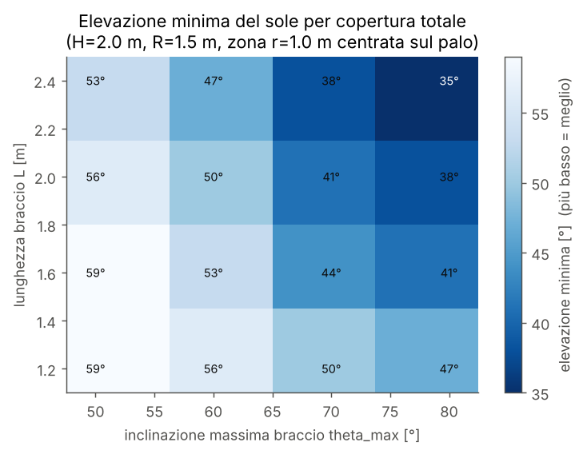
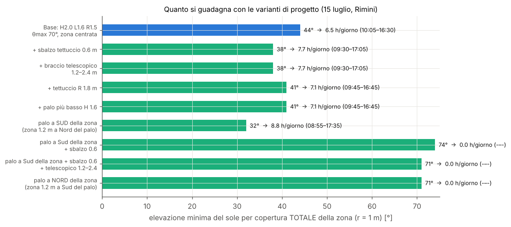
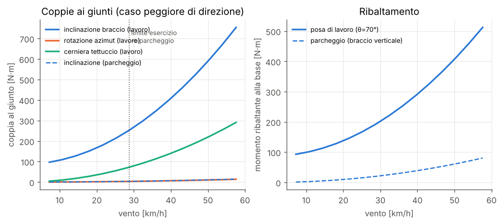
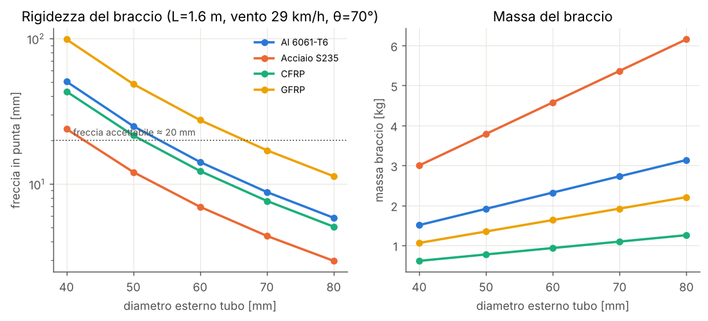
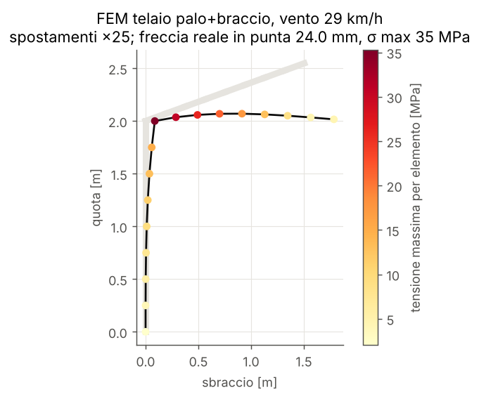

# Risultati della simulazione

Generato il 2026-10-17 13:58 con `python -m ombrellone.simulate`. Località: Rimini (44.06N, 12.57E), fuso CEST.

## Progetto base

| parametro | valore |
|---|---|
| H | 2.0 |
| L | 1.6 |
| R | 1.5 |
| theta_max_deg | 70.0 |
| beta_max_deg | 70.0 |
| h_min | 1.6 |
| canopy_offset | 0.0 |
| L_min | None |
| L_max | None |
| pole_radius | 0.04 |
| alpha_min_deg | -1000000000.0 |
| alpha_max_deg | 1000000000.0 |
| zona | {'x': 0, 'y': 0, 'r': 1.0} |

## Giornata tipo (15 luglio), zona r = 1 m centrata sul palo

| metrica | valore |
|---|---|
| ore_di_sole_(elev>5°) | 14.0 |
| finestra_copertura_totale | 10:00–16:30 |
| ore_copertura_totale | 6.7 |
| buchi_(copertura_parziale) | 06:20–10:00, 16:40–20:10 |
| copertura_media_tenuta_% | 60.9 |
| copertura_minima_tenuta_% | 0.0 |
| movimenti_al_giorno | 31 |
| corsa_totale_giunti_gradi | 645 |








## Giornata di confronto (21 settembre)

| metrica | valore |
|---|---|
| ore_di_sole_(elev>5°) | 11.2 |
| finestra_copertura_totale | 12:00–14:10 |
| ore_copertura_totale | 2.3 |
| buchi_(copertura_parziale) | 07:30–12:00, 14:20–18:30 |
| copertura_media_tenuta_% | 48.3 |
| copertura_minima_tenuta_% | 0.0 |
| movimenti_al_giorno | 41 |
| corsa_totale_giunti_gradi | 447 |

## Limiti geometrici



### Varianti di progetto

| variante | elev. min. sole a Sud | a Sud-Est | a Est | ore copertura totale 15 lug (sole a Sud) | finestra |
|---|---|---|---|---|---|
| Base: H2.0 L1.6 R1.5 θmax 70°, zona centrata | 44.0° | 44.0° | 44.0° | 6.5 h | 10:05–16:30 |
| + sbalzo tettuccio 0.6 m | 38.0° | 38.0° | 38.0° | 7.7 h | 09:30–17:05 |
| + braccio telescopico 1.2–2.4 m | 38.0° | 38.0° | 38.0° | 7.7 h | 09:30–17:05 |
| + tettuccio R 1.8 m | 41.0° | 41.0° | 41.0° | 7.1 h | 09:45–16:45 |
| + palo più basso H 1.6 | 41.0° | 41.0° | 41.0° | 7.1 h | 09:45–16:45 |
| palo a SUD della zona (zona 1.2 m a Nord del palo) | 32.0° | 41.0° | 56.0° | 8.8 h | 08:55–17:35 |
| palo a Sud della zona + sbalzo 0.6 | 74.0° | 32.0° | 41.0° | 0.0 h | -–- |
| palo a Sud della zona + sbalzo 0.6 + telescopico 1.2–2.4 | 71.0° | 29.0° | 35.0° | 0.0 h | -–- |
| palo a NORD della zona (zona 1.2 m a Sud del palo) | 71.0° | 65.0° | 56.0° | 0.0 h | -–- |




## Meccanica

| massa | kg |
|---|---|
| tettuccio | 4.7 |
| braccio | 2.3 |
| palo | 5.2 |
| snodo | 3.0 |
| elettronica | 1.0 |

| carico (vento 8 m/s = 29 km/h, posa di massimo sbraccio) | valore |
|---|---|
| coppia_inclinazione_Nm | 253 |
| coppia_azimut_Nm | 3 |
| coppia_tettuccio_Nm | 73 |
| momento_base_Nm | 193 |
| forza_vento_tettuccio_N | 204 |

| carico (vento 15 m/s = 54 km/h, parcheggio) | valore |
|---|---|
| coppia_inclinazione_Nm | 13 |
| momento_base_Nm | 71 |

| zavorra richiesta (coeff. sicurezza 1.5) | kg |
|---|---|
| base_r0.4_lavoro_8ms | 80 |
| base_r0.5_lavoro_8ms | 60 |
| base_r0.6_lavoro_8ms | 48 |
| parcheggio 15 m/s, base r=0.5 | 6 |

### Attuatori

```json
{
  "azimut_stepper_vite_senza_fine": {
    "joint": "azimut",
    "holding_torque_Nm": 3.394801219719869,
    "design_torque_Nm": 6.789602439439738,
    "output_speed_rpm": 0.5,
    "gear_ratio": 60,
    "motor_torque_Nm": 0.2514667570162866,
    "power_W": 0.7900061164644155,
    "suggestion": "NEMA17 stepper (0.4-0.5 Nm) o DC 12V 30-50 W con riduttore"
  },
  "inclinazione_attuatore_lineare": {
    "giunto": "inclinazione",
    "forza_N": 3377.8166866924485,
    "corsa_mm": 172.0729309053138,
    "velocita_mm_s": 4.301823272632845,
    "braccio_leva_m": 0.15,
    "suggerimento": "attuatore 12/24 V classe 3000-6000 N"
  },
  "tettuccio_attuatore_lineare": {
    "giunto": "tettuccio",
    "forza_N": 1818.3930978059423,
    "corsa_mm": 91.77222981616737,
    "velocita_mm_s": 3.059074327205579,
    "braccio_leva_m": 0.08,
    "suggerimento": "attuatore 12/24 V classe 3000-6000 N"
  }
}
```




## Materiali del braccio

| materiale | D [mm] | t [mm] | massa [kg] | freccia [mm] | σ [MPa] | coeff. sicurezza |
|---|---|---|---|---|---|---|
| Al 6061-T6 | 40 | 3 | 1.51 | 50.6 | 83 | 3 |
| Al 6061-T6 | 50 | 3 | 1.91 | 25.0 | 51 | 5 |
| Al 6061-T6 | 60 | 3 | 2.32 | 14.1 | 35 | 7 |
| Al 6061-T6 | 70 | 3 | 2.73 | 8.8 | 25 | 9 |
| Al 6061-T6 | 80 | 3 | 3.14 | 5.8 | 19 | 12 |
| Acciaio S235 | 40 | 2 | 3.00 | 23.9 | 120 | 2 |
| Acciaio S235 | 50 | 2 | 3.79 | 12.1 | 76 | 3 |
| Acciaio S235 | 60 | 2 | 4.58 | 7.0 | 53 | 4 |
| Acciaio S235 | 70 | 2 | 5.37 | 4.4 | 39 | 6 |
| Acciaio S235 | 80 | 2 | 6.16 | 3.0 | 30 | 8 |
| CFRP | 40 | 2 | 0.61 | 43.2 | 112 | 4 |
| CFRP | 50 | 2 | 0.77 | 21.6 | 70 | 7 |
| CFRP | 60 | 2 | 0.93 | 12.3 | 48 | 10 |
| CFRP | 70 | 2 | 1.09 | 7.6 | 35 | 14 |
| CFRP | 80 | 2 | 1.25 | 5.1 | 26 | 19 |
| GFRP | 40 | 3 | 1.06 | 98.8 | 82 | 4 |
| GFRP | 50 | 3 | 1.35 | 48.6 | 50 | 6 |
| GFRP | 60 | 3 | 1.63 | 27.5 | 34 | 9 |
| GFRP | 70 | 3 | 1.92 | 17.0 | 25 | 12 |
| GFRP | 80 | 3 | 2.21 | 11.3 | 19 | 16 |




## FEM telaio

```json
{
  "freccia_punta_mm": 24.041733745098433,
  "sigma_max_MPa": 35.276448270084714,
  "sigma_amm_Al_MPa": 240.0
}
```




## Leggi di scala per il mini (1:10)

```json
{
  "scala_lunghezze": 0.1,
  "H_m": 0.2,
  "L_m": 0.16000000000000003,
  "R_m": 0.15000000000000002,
  "fattore_aree_e_forze_vento": 0.010000000000000002,
  "fattore_masse": 0.0010000000000000002,
  "fattore_momenti_gravita": 0.00010000000000000002,
  "fattore_momenti_vento": 0.0010000000000000002,
  "nota": "a parita' di vento il mini e' relativamente PIU' robusto: valida software e cinematica, non la struttura"
}
```
