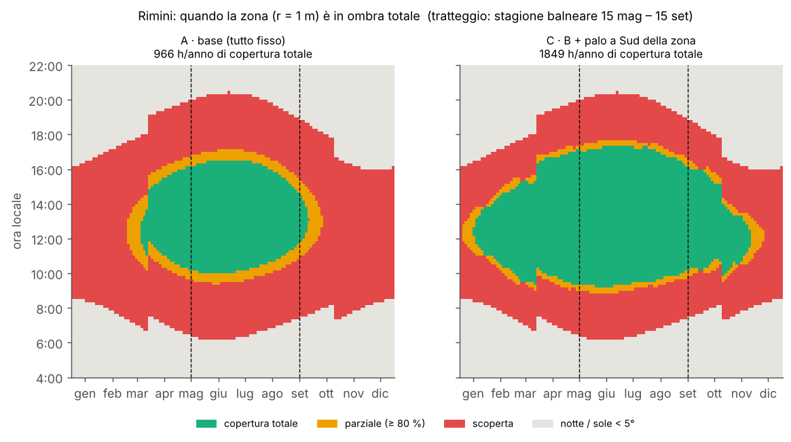
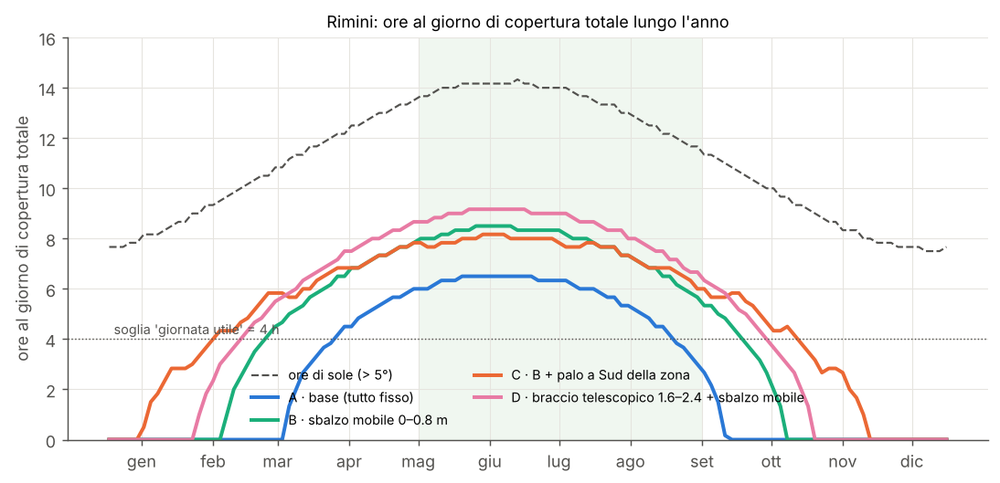
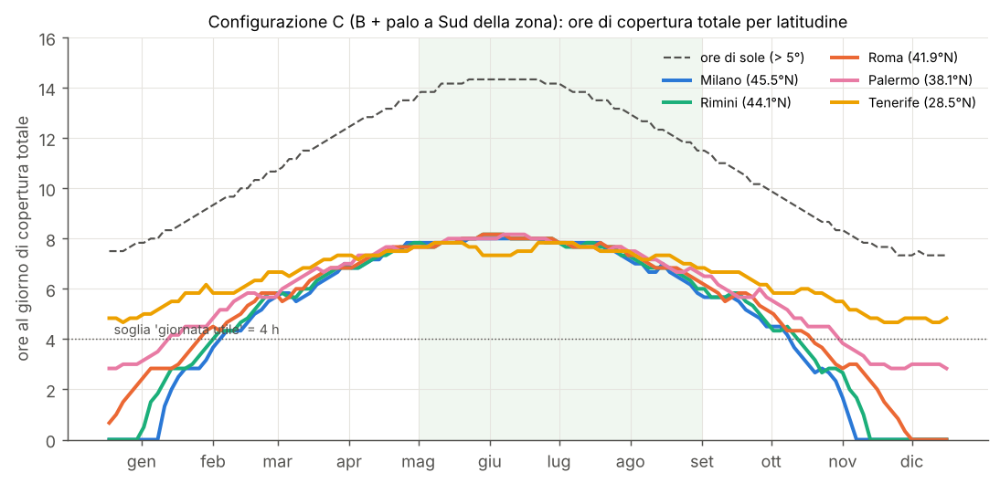

# Stagionalità: quando l'ombrellone è utilizzabile (e vendibile)

Generato il 2026-10-17 14:42 con `python -m ombrellone.stagionalita`. Zona da coprire: cerchio r = 1 m. "Copertura totale" = tutta la zona in ombra; "giornata utile" = almeno 4 h di copertura totale.

La fattibilità dipende solo dalla direzione del sole: è stata calcolata una volta su una griglia (elevazione ogni 2.0°, azimut ogni 15.0°) e applicata a tutto l'anno (un giorno ogni 3, passo 10 min).

## Configurazioni

| sigla | configurazione |
|---|---|
| A | progetto base: H 2.0, L 1.6, R 1.5, θmax 70°, zona centrata sul palo |
| B | A + sbalzo mobile 0–0.8 m (carrello sotto il tettuccio) |
| C | B + palo a Sud della zona (zona 1.2 m a Nord del palo) |
| D | A + braccio telescopico 1.6–2.4 m + sbalzo mobile 0–0.8 m |

## Rimini: calendario





## Rimini: tabella mensile (ore medie al giorno di copertura totale)

| mese | ore sole | A | B | C | D | giorni utili (≥4 h) C |
|---|---|---|---|---|---|---|
| gen | 8.1 | 0.0 | 0.0 | 1.1 | 0.0 | 0 % |
| feb | 9.4 | 0.0 | 0.6 | 3.8 | 2.1 | 56 % |
| mar | 10.9 | 0.9 | 4.5 | 5.6 | 5.5 | 100 % |
| apr | 12.3 | 4.4 | 6.6 | 6.8 | 7.4 | 100 % |
| mag | 13.6 | 6.0 | 7.9 | 7.7 | 8.6 | 100 % |
| giu | 14.2 | 6.5 | 8.4 | 8.1 | 9.2 | 100 % |
| lug | 13.9 | 6.2 | 8.2 | 7.8 | 8.9 | 100 % |
| ago | 12.9 | 5.2 | 7.2 | 7.2 | 8.0 | 100 % |
| set | 11.5 | 2.5 | 5.5 | 6.1 | 6.4 | 100 % |
| ott | 9.9 | 0.0 | 1.9 | 4.6 | 3.6 | 82 % |
| nov | 8.4 | 0.0 | 0.0 | 1.9 | 0.0 | 0 % |
| dic | 7.7 | 0.0 | 0.0 | 0.0 | 0.0 | 0 % |

| configurazione | ore/anno di copertura totale | giorni utili/anno (≥4 h) | giorni utili nella stagione balneare (15 mag–15 set, 123 gg) |
|---|---|---|---|
| A · base (tutto fisso) | 966 | 147 | 111 |
| B · sbalzo mobile 0–0.8 m | 1547 | 206 | 123 |
| C · B + palo a Sud della zona | 1849 | 254 | 123 |
| D · braccio telescopico 1.6–2.4 + sbalzo mobile | 1816 | 230 | 123 |

## Latitudini (configurazione C)



| località | ore/anno copertura totale | giorni utili/anno | mesi con ≥ 4 h/giorno in media |
|---|---|---|---|
| Milano (45.5°N) | 1786 | 248 | mar, apr, mag, giu, lug, ago, set, ott |
| Rimini (44.1°N) | 1849 | 254 | mar, apr, mag, giu, lug, ago, set, ott |
| Roma (41.9°N) | 1967 | 266 | feb, mar, apr, mag, giu, lug, ago, set, ott |
| Palermo (38.1°N) | 2157 | 290 | feb, mar, apr, mag, giu, lug, ago, set, ott |
| Tenerife (28.5°N) | 2375 | 365 | gen, feb, mar, apr, mag, giu, lug, ago, set, ott, nov, dic |

## Elevazione minima del sole per azimut (dalle mappe)

```json
{
 "A · base (tutto fisso)": {
  "elev_min_per_az": {
   "180": 45.0
  }
 },
 "B · sbalzo mobile 0–0.8 m": {
  "elev_min_per_az": {
   "180": 35.0
  }
 },
 "C · B + palo a Sud della zona": {
  "elev_min_per_az": {
   "0": 53.0,
   "15": 53.0,
   "30": 51.0,
   "45": 49.0,
   "60": 45.0,
   "75": 43.0,
   "90": 37.0,
   "105": 35.0,
   "120": 33.0,
   "135": 29.0,
   "150": 27.0,
   "165": 25.0,
   "180": 25.0
  }
 },
 "D · braccio telescopico 1.6–2.4 + sbalzo mobile": {
  "elev_min_per_az": {
   "180": 31.0
  }
 }
}
```